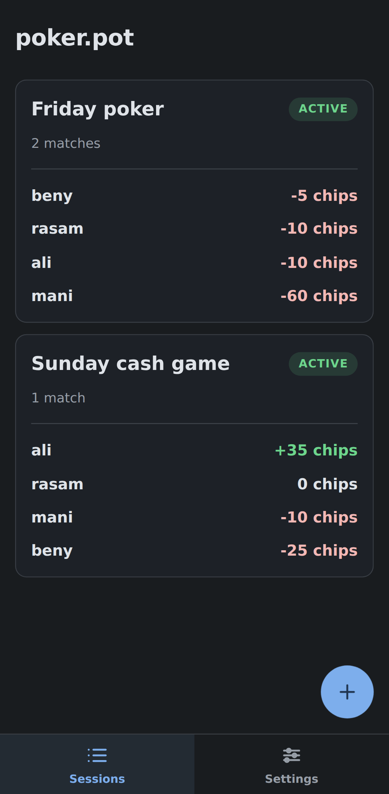
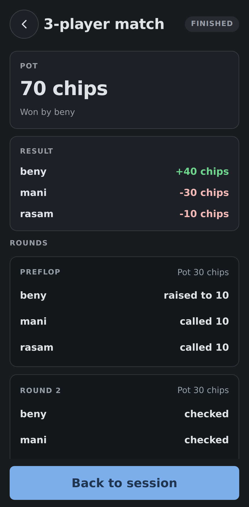
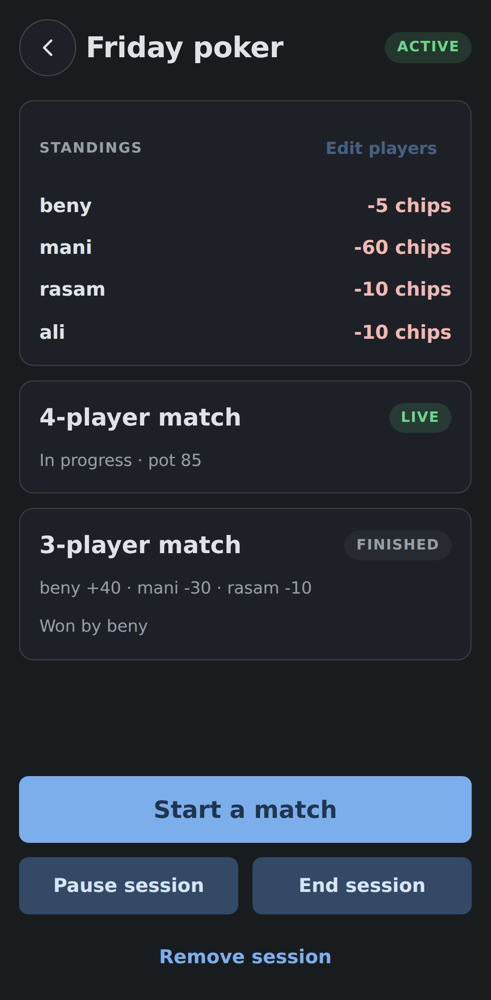
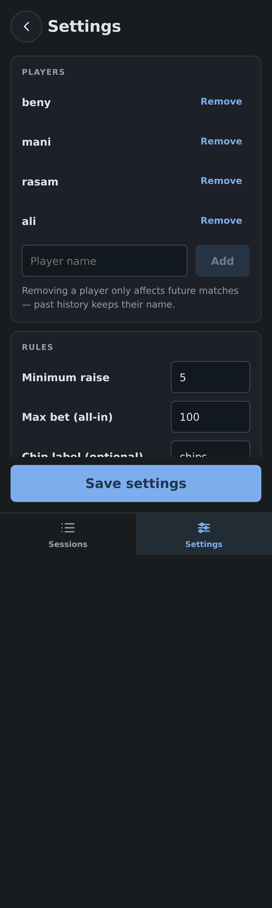
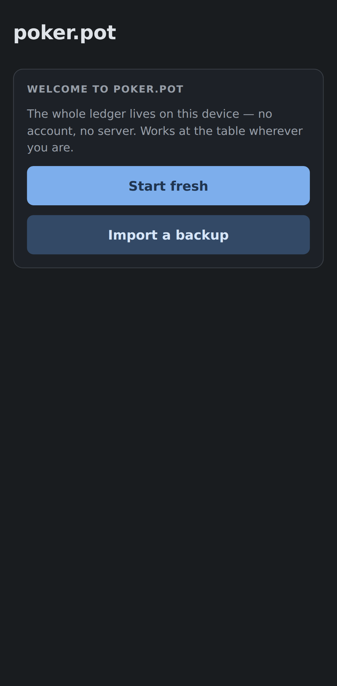
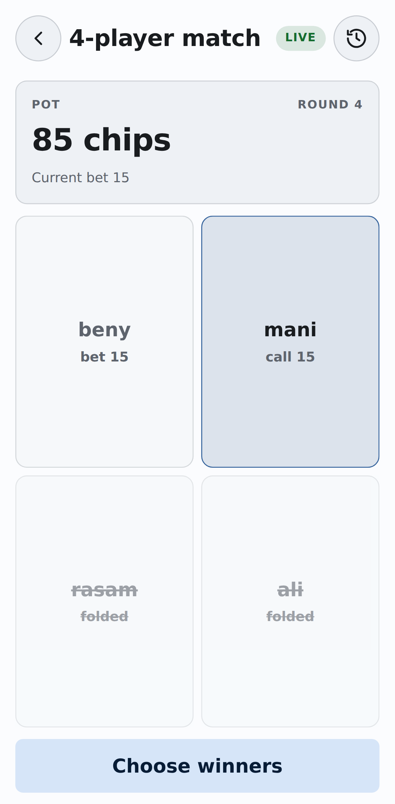
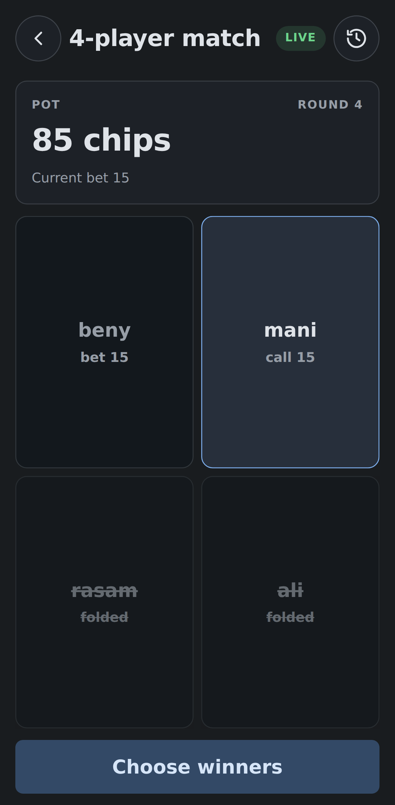
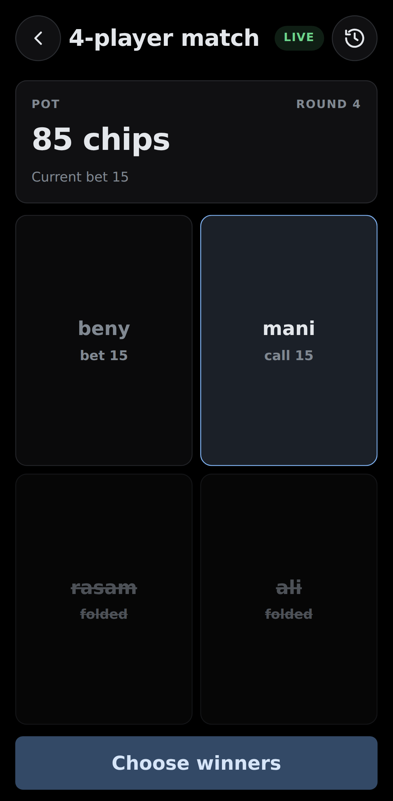

# poker.pot

A phone-viewport pot manager for poker games with friends. It keeps a betting
ledger for standard betting rounds or simple final-result matches, without
dealing cards or ranking hands.

> **Not standard poker.** poker.pot runs a custom house ruleset with no blinds,
> no fixed turn order, and no hand ranking. The full ruleset is in
> [rules.md](rules.md). This project is licensed under the [MIT](LICENSE).

## Download

| Platform | Download |
| --- | --- |
| Android | [poker.pot-0.2.0-android-universal.apk](https://github.com/benyamin-git/poker.pot/releases/download/v0.2.0/poker.pot-0.2.0-android-universal.apk) |

The APK is a signed universal build for sideloading; there is no store listing.
Older versions and prereleases are on the
[releases page](https://github.com/benyamin-git/poker.pot/releases).

## Screenshots

### Phone

| Sessions | Live match | History |
| --- | --- | --- |
|  |  |  |

| Session overview | Settings | First-run setup |
| --- | --- | --- |
|  |  |  |

| Light | Dark | OLED |
| --- | --- | --- |
|  |  |  |

The captures use demo data in Dark; the theme strip shows the same live match
in Light / Dark / OLED. The screenshot script and its transient port are
documented in [AGENTS.md](AGENTS.md).

## What's new in v0.2.0

- **Simple mode** — new matches can skip betting rounds and record only the
  final money that changed hands.
- **Multiple winners** — split a simple result between any number of winners;
  the app checks that the winnings equal the losers' total.

See the [changelog](CHANGELOG.md) for details.

## Install

### Android

Download the APK above and sideload it. The build is signed with the project
keystore and is not distributed through a store.

### iPhone / iPad

Open `https://benyamin-git.github.io/poker.pot/` in Safari, tap Share, then
**Add to Home Screen**. The app installs with its own icon and works offline.

## Features

- **Two match modes** — standard betting rounds, or simple mode with only the
  final result.
- **Shared ledger** — one phone is passed around; each player records their own
  action, and changes are saved on-device immediately.
- **Multiple winners** — simple results can be split between any number of
  winners.
- **Editable history** — actions and simple results can be edited, and
  standings recompute.
- **On-device and offline** — IndexedDB storage, no account, no server;
  installable as a PWA or Android APK.
- **Backups** — one YAML file, with replace and merge import.
- **Themes** — Light, Dark, and OLED, with six accents (blue by default).

## Data and backups

Everything lives in the browser's IndexedDB on the installing device: players,
limits, sessions, and history. There is no server-side store.

Backups are a single YAML file. Export it from Settings → Data, then import it
on another device:

- **Replace** wipes local data and loads the backup.
- **Merge** applies the backup into local data; conflicts are shown one at a
  time and each is resolved per item.

Export a backup before switching phones or clearing browser data. Browser
storage can be evicted under disk pressure; the exported file is the durable
copy. Keep it somewhere safe. Importing the same file twice replaces or merges
by your choice; it never duplicates.

Simple results are part of the same backup. A single-winner result from an
older backup is converted to the per-winner shape on import.

## Rules

The full ruleset is in [rules.md](rules.md). In short:

Standard matches use the betting rounds below; simple mode skips them.

- Every session starts at zero. Balances can go negative; it is a ledger, not a
  stack of physical chips.
- Preflop, you can fold or raise but not check, so the first player must open
  with at least `minRaise`. Calls are allowed once there is a bet.
- Later rounds, check when there is no bet; otherwise fold, call (match the
  round's highest bet), or raise (beat it by at least `minRaise`).
- A raise reopens the action for anyone who already acted and is now behind.
- `maxBet` is cumulative across the whole match. Hitting it is all-in; that
  player sits out further rounds but can still win.
- Folding is final, and folding as the last active player is blocked. If
  everyone else folds, the last player wins automatically.
- Winners are chosen manually from the players who have not folded. The pot is
  split equally; leftover chips go to random winners, and the assignment is
  stored so history never changes.
- In simple mode, there are no betting rounds: pick one or more winners, enter
  what each loser paid and what each winner received, and save. The winners'
  total must equal the losers' total.

Chip counts are integers.

## Development

Requires [Bun](https://bun.sh).

```bash
bun install
bun run dev
```

`bun run dev` starts Vite on `0.0.0.0:7404` with `strictPort` enabled. Open
`http://<computer-ip>:7404` on a phone.

To serve the built app over the LAN:

```bash
bun run build
bun start
# or, for a detached background server:
./scripts/live.sh
```

`bun start` serves `dist/` on `0.0.0.0:7403`; the port comes from `PORT`
(default `7403`). `scripts/live.sh` starts the same server detached, building
`dist/` first if needed, and refuses to start if the port is bound. It logs to
`/tmp/poker.pot-liveserver.log`, writes a pid to
`/tmp/poker.pot-liveserver.pid`, and prints the stop command. Override the port
with `LIVE_SERVER_PORT`.

### Scripts

- `bun run test` — Vitest suite.
- `bun run test:watch` — Vitest in watch mode.
- `bun run typecheck` — TypeScript check.
- `bun run lint` — Biome check.
- `bun run format` — Biome format.
- `bun run theme` — regenerate `src/client/styles/tokens.css` from the palette
  in `src/client/theme.ts`. The file is committed and never hand-edited.
- `bun run icons` — rasterize `public/poker-chip-logo.svg` into `public/icons/`.
- `bun run version:set <x.y.z>` — rewrite the version in `package.json` and
  `src-tauri/Cargo.toml` (and the local lockfile if one exists) before tagging a
  release.

`bin/dev`, `bin/build`, and `bin/run` are wrappers around the matching `bun`
commands for shell aliasing.

### Release and versioning

Every push to `main` runs the test suite (`ci.yml`) and deploys the PWA
(`pages.yml`) to `https://benyamin-git.github.io/poker.pot/`.

To ship a version, update `CHANGELOG.md`, then stage the manifests and changelog
explicitly. For example, to ship `0.3.0`:

```bash
bun run version:set 0.3.0
git add package.json src-tauri/Cargo.toml CHANGELOG.md
git commit -m "Release v0.3.0"
git tag v0.3.0
git push origin main v0.3.0
```

The tag push builds a signed Android APK with the release keystore (secrets:
`ANDROID_KEY_BASE64`, `ANDROID_KEY_ALIAS`, `ANDROID_KEY_PASSWORD`) and opens a
draft release with the APK attached. Publish the draft after verifying it on a
device. `CHANGELOG.md` keeps a log of what changed per version.

### Tests

`bun run test` runs the Vitest suite (Node environment, no browser):

- `domain` — replay, raises/calls/folds, all-in, simple results, and winner
  payouts.
- `domain-commands` — history edits, session lifecycle, simple-result
  validation, and error codes.
- `domain-invariants` — seeded random valid play asserting the ledger stays
  zero-sum.
- `config` — `validateConfig` and `resolvePlayers`.
- `server-static` — static serving, index fallback, and path traversal defense.
- `storage` — Dexie store, meta, and revision handling (fake-indexeddb).
- `backup` and `backup-flow` — YAML bundle round-trips, replace/merge, conflict
  resolution, and legacy simple-result normalization.
- `onboarding`, `client-format`, and `ui` — the first-run gate, client helpers,
  and smoke renders.
- `icons` — generated icon set invariants.
- `theme` and `theme-runtime` — token generator invariants (documented
  primaries, every accent × theme role set, contrast, committed CSS) and
  appearance persistence.
- `match-turn` — the live match's next-player selection.

## Project layout

```text
src/domain/    pure ledger engine (sessions, matches, rounds, simple results, winners)
src/server/    static file server for the built client
src/client/    React + Vite app (on-device storage, backup, themes, match UI)
src-tauri/     Tauri Android shell (signed APK builds)
public/icons/  generated app icons
tests/         Vitest suites
scripts/       theme, icon and screenshot generators, version bump,
               artifact collection
dist/          build output, generated by bun run build
```
